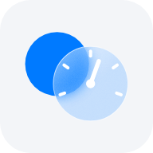
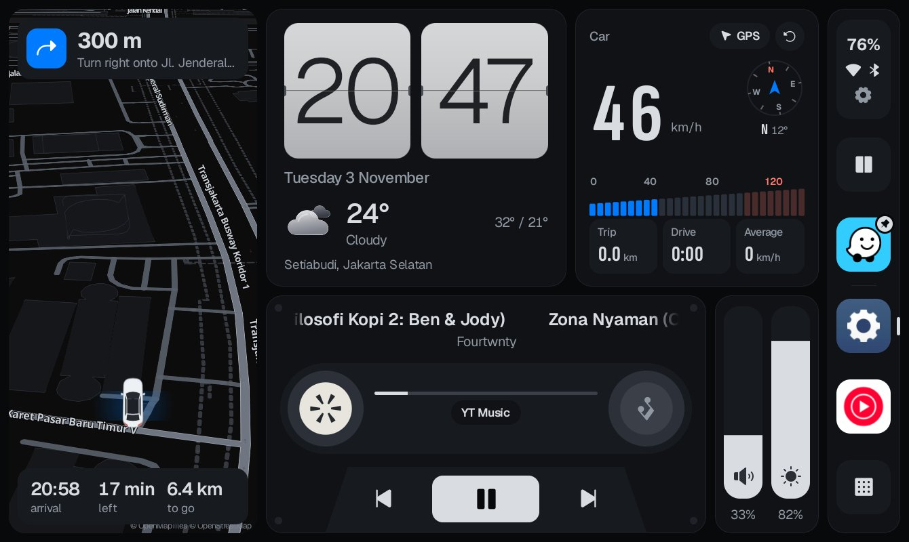
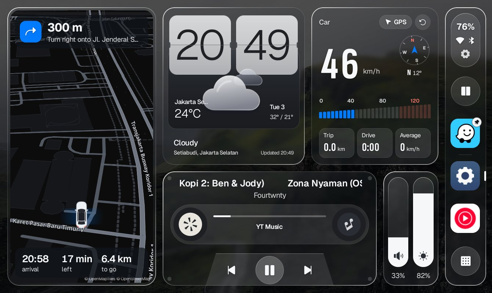
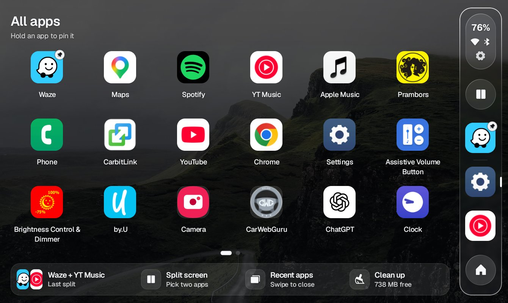
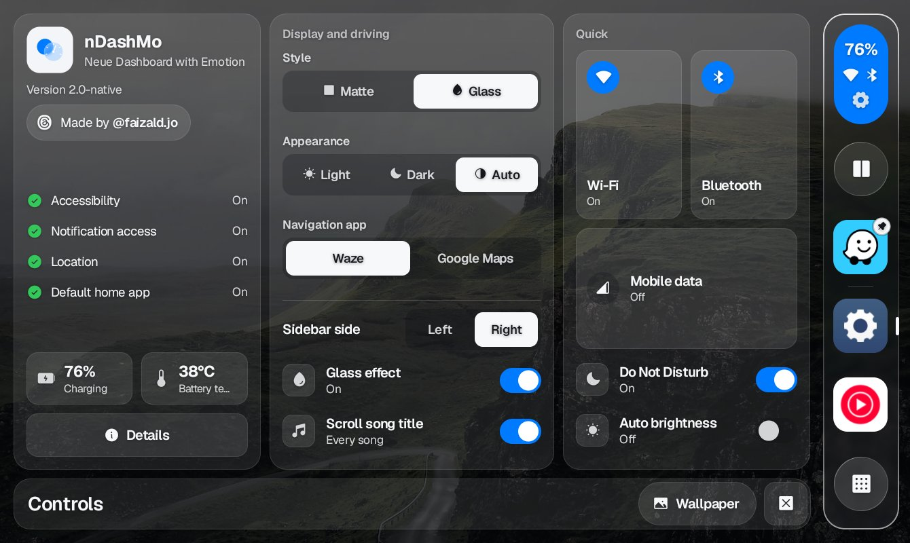
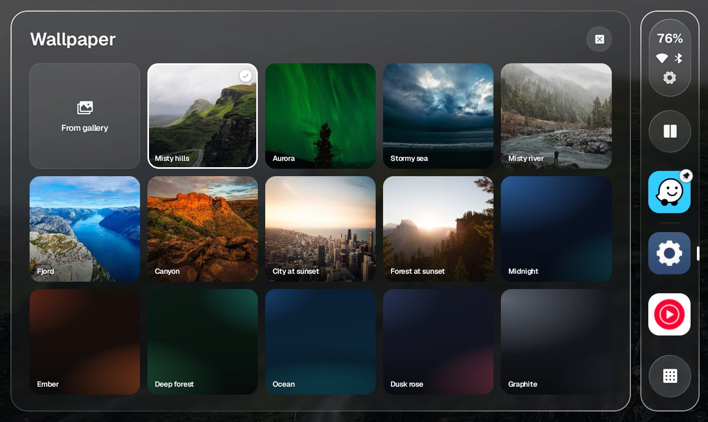
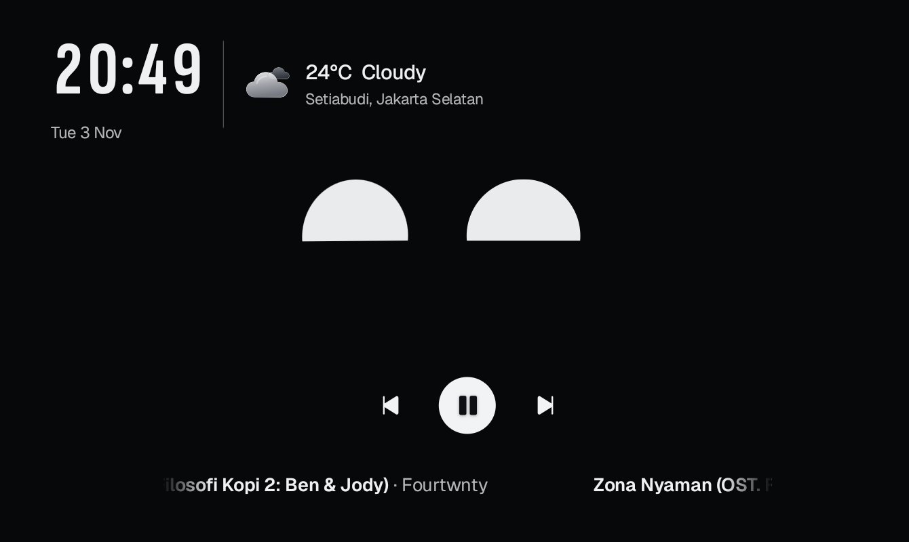

<p align="center">
  
</p>

<h1 align="center">nDashMo</h1>

<p align="center"><b>Neue Dashboard with Emotion</b><br>
A car home screen for an Android tablet as your car head unit.</p>

<p align="center">
  
  
</p>

nDashMo puts the map, music, clock, weather and your speed in one dashboard, and replaces the tablet's home screen.
It has two looks: **Matte** (flat and dark, with a light version by day) and **Glass** (see-through panels over a photo
wallpaper). Built and tested on a Samsung Galaxy Tab A7 Lite (Android 14, One UI 6.1). Made by
[@faizald.jo](https://www.threads.com/@faizald.jo).

## What it does

- **Map**: a tilted driving view that turns with the car, the street you are on, and the speed limit when
  OpenStreetMap knows it. With Google Maps navigating, the next turn and the arrival time show on the map. Tap the map
  to open Waze or Google Maps.
- **Today**: a flip clock, the weather where you are, and the place name.
- **Car**: GPS speed, a compass, a speed bar, and the trip (distance, driving time, average). The trip starts again
  each time the car is switched off.
- **Music**: whatever is playing (YouTube Music, Spotify, radio apps), shown as a cassette, with the controls.
  Long titles scroll.
- **Volume and brightness** bars, and a thin strip on the screen edge to change them over other apps.
- **Sidebar**: battery and connection, split screen with two apps, your pinned and recent apps, All apps.
- **Car power**: unplug the charger (car off) and the music pauses and the screen sleeps; plug in (car on) and it
  wakes to the home screen and the music carries on.
- **Screensaver**: a friendly face (bbot) with the clock and the song, after 5 minutes without a touch while
  charging. Play with it: hold, rub, double tap.
- **Gestures**: swipe left for All apps, right for the screensaver; two fingers up or down for volume, right for
  recent apps, left for the last split screen.

<p align="center">
  
  
  
</p>
<p align="center">
  
</p>

## Install the APK

You need an Android tablet (or car head unit) with **Android 8 or newer**. No computer needed.

1. On the tablet, download `nDashMo-1.0.apk` from this repo's
   [Releases](https://github.com/faizaldjoo/nDashmo-app/releases).
2. Open it. Android asks to allow installing apps from your browser (or Files): allow it, then tap **Install**.
   If Play Protect warns about an unknown developer, choose **More details > Install anyway**.
3. **Android 13 and newer:** Settings > Apps > nDashMo > ⋮ (top right) > **Allow restricted settings**. Without this,
   Accessibility and Notification access stay greyed out for an app installed from an APK.
4. Open nDashMo and allow **Location** (speed, map and weather).
5. Press **Home** and choose **nDashMo**, then **Always** (or Settings > Apps > Default apps > Home app).
6. Open **Controls** (tap the battery pill at the top of the sidebar) > **Details**. The About page lists what is
   still off and opens the right setting for each:
   - **Notification access**: the song, the music controls and the turn card.
   - **Accessibility**: sleep when unplugged, wake when plugged in, split screen, recent apps and the edge strip.
   - The brightness bar asks once for **Modify system settings**.

### Will it work on my device?

nDashMo is built and tested on a Samsung Galaxy Tab A7 Lite (Android 14). It should also run on other Android
tablets and on Android car head units, with these limits:

- **Needs** Android 8 or newer on an ARM processor (nearly all tablets and head units; not the rare x86 head units).
- **Screen:** landscape, about 1024 x 600 or larger (common head units are 1024 x 600 or 1280 x 720; 8 to 10 inch
  tablets are fine). It always runs in landscape; very small screens (800 x 480) will feel cramped.
- **Split screen:** on Samsung (One UI) nDashMo opens it through One UI's own menu. On other devices it uses
  Android's own split screen, which most Android 7 to 11 tablets and head units allow; some devices and newer Android
  versions don't let apps start it, and nDashMo says so.
- **Bluetooth button:** Samsung's Bluetooth pop-up on Samsung, Android's Bluetooth settings on other devices.
- **Head units without a battery** are always "charging": the screen does not sleep when the car is switched off (the
  car powers the unit down itself), and the battery shows 100%.
- **Without Google services** (some head units), the place name may not show; the map, weather and speed still work.
- **Some head units do not let you change the Home app.** nDashMo then runs as a normal app you open from the app list.

Tried it on another device? Tell us how it went in an [issue](https://github.com/faizaldjoo/nDashmo-app/issues).

### Updating

Install the new APK over the old one: everything you set stays. On some tablets an update switches nDashMo's
**Accessibility** off again; Controls shows a warning until you turn it back on (Settings > Accessibility >
Installed apps > nDashMo).

### Good to know

- The map, weather and speed limits need an internet connection (mobile data is fine).
- It never switches Bluetooth, Wi-Fi or mobile data by itself: those buttons open Android's own panels.

## Remove bloatware and ads (optional)

Tablets and head units often come with apps you never use, and some show ads. nDashMo does not remove apps itself
(Android doesn't let a normal app do that), but you can do it in a few minutes from a computer, letting an AI agent
such as [Claude Code](https://claude.com/claude-code) do the typing. This is how the tablet nDashMo was built on was
cleaned up.

**What you need:** a computer (Mac, Windows or Linux) with Android's
[platform-tools](https://developer.android.com/tools/releases/platform-tools) (`adb`), on the same Wi-Fi as the tablet.

1. **On the tablet:** Settings > About > Software information > tap **Build number** 7 times. Then Settings >
   Developer options > **Wireless debugging** on > **Pair device with pairing code**.
2. **On the computer:** `adb pair <ip>:<port>` with the code the tablet shows, then `adb connect <ip>:<port>` (the
   address on the Wireless debugging screen). `adb devices` should list the tablet.
3. **Start the AI agent** in a terminal and paste this:

   ```text
   My Android tablet is connected over adb (check with `adb devices`). I use it as a car head unit with
   nDashMo (me.faizal.carhome) as the home app. Help me remove bloatware and ads safely:
   1. List the installed packages (adb shell pm list packages) and sort them into: ads and tracking,
      the maker's extras I probably don't need, and system apps I must keep.
   2. Show me the list and wait for my OK before removing anything. Never remove anything needed to start
      the tablet, the system UI, Settings, the keyboard, Wi-Fi, Bluetooth, mobile data / SIM, Google Play
      services, the Play Store, or nDashMo.
   3. Remove only what I approve, one by one, with `adb shell pm uninstall --user 0 <package>` (it can be
      undone), and save the list to removed-packages.txt.
   4. Write restore.sh, which puts every one of them back with `adb shell cmd package install-existing <package>`.
   ```

**Ads everywhere:** on the tablet, set **Private DNS** to an ad-blocking DNS. Samsung: Settings > Connections > More
connection settings > Private DNS; other devices: Settings > Network & internet > Private DNS. Choose "Private DNS
provider hostname" and enter `dns.adguard-dns.com`. It blocks most ads in apps and browsers, with no extra app and no
battery cost. To undo it, set Private DNS back to Automatic.

**To undo the clean-up:** run `restore.sh`, or put any single app back with
`adb shell cmd package install-existing <package>`. A factory reset also brings every app back.

**At your own risk.** Removing the wrong system app can break a feature (or a whole device on some head units), so
read the list before you approve it, and keep `removed-packages.txt` and `restore.sh`. Afterwards, turn Wireless
debugging off again.

## Report a problem

Open an [issue](https://github.com/faizaldjoo/nDashmo-app/issues): what happened, what you expected, your tablet
(or head unit) model and Android version, and a screenshot if you can. Controls > Details > **Drive log** shows what
nDashMo did and when (power in and out, the screensaver, split screen); a photo of it helps with anything to do with
the car.

New versions appear under [Releases](https://github.com/faizaldjoo/nDashmo-app/releases). Install the new APK over
the old one: your settings stay.

## Credits

Map data © OpenStreetMap contributors, OpenMapTiles, OpenFreeMap; MapLibre Native. Weather Open-Meteo, weather icons
Weatherglass. Icons Phosphor. Speed limits Overpass API. Screensaver face bbot by bwnd (MIT).
